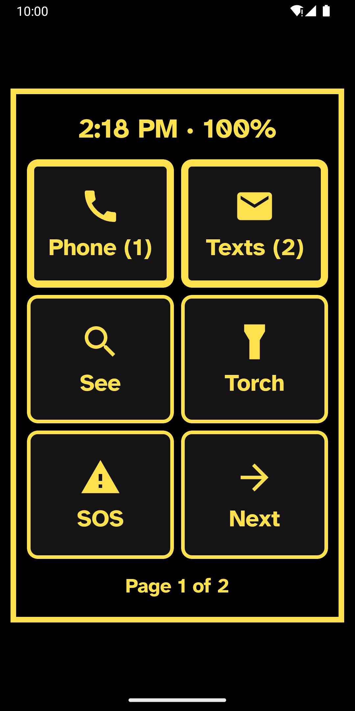
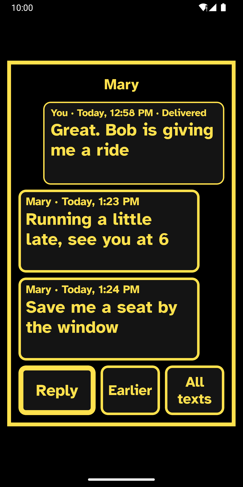
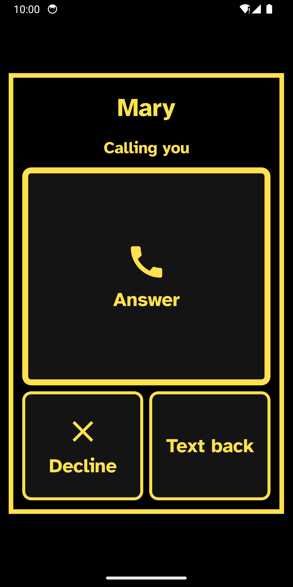
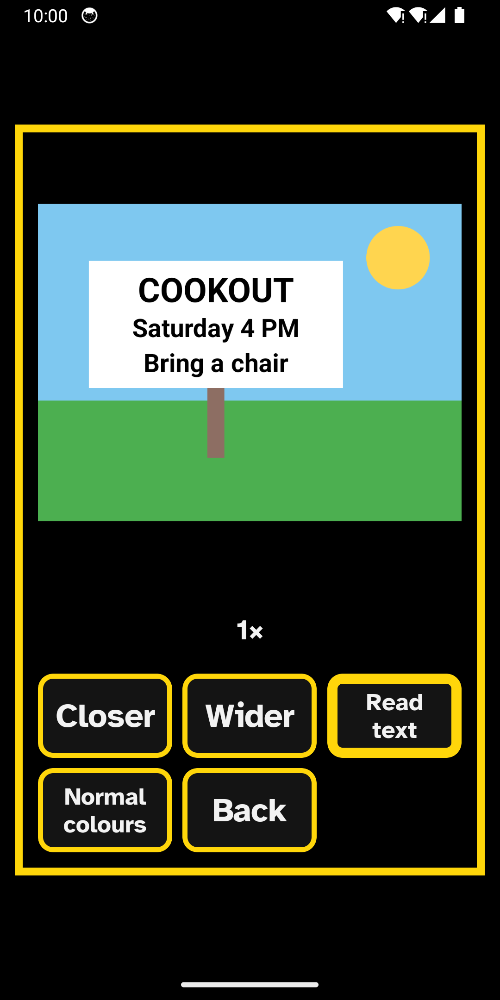

<h1 align="center"></h1>

<p align="center"><b>An Android home screen for people with retinitis pigmentosa (RP).</b><br>
Everything fits inside the part of the screen you can see.</p>

Most low-vision tools make things bigger. RP mainly narrows the field of view, so RP
Launcher makes things **fit**: every tile, label and alert sits inside the part of the
screen the person can actually see, on a dark, glare-free background. It works from early
tunnel vision through to speech-first use.

<p align="center">
  
  
  
  
</p>

## Get it

- **F-Droid:** submitted and waiting for review
  ([merge request](https://gitlab.com/fdroid/fdroiddata/-/merge_requests/53136)). This will
  be the main way to install it.
- **Google Play:** coming later.
- **Newest test build:** open [Releases](https://github.com/netgician/rp-launcher/releases)
  on the phone, tap `rp-launcher-test.apk` under **Latest test build**, and allow installing
  from your browser. Test builds are for trying changes first. They can't update an F-Droid
  copy, or the other way round, so save the setup to a file before switching.

Needs Android 10 or newer.

## What it does

- **Fits the viewing window.** At first start, a bright frame grows or shrinks until all
  four corners can just be seen. Every screen fits inside it afterwards.
- **Big, clear tiles** in Atkinson Hyperlegible type, turned page by page with big Next and
  Back tiles, never by swiping. Dark themes only, with night amber and red.
- **Everything can be read aloud,** with three vision modes (sight first, sight and speech,
  speech first). It also works with TalkBack.
- **See and Read:** the camera as a magnifier, and printed text read aloud on the phone itself.
- **Texts and Phone built in:** big screens for texts, picture texts, group texts and calls.
  Every send says "Sent" or "Not sent".
- **Alerts:** new notifications shown large and read aloud, one at a time.
- **SOS and Where am I:** a cancellable countdown that texts your address to chosen people,
  and the street address read aloud.
- **For helpers:** a setup checklist, settings behind an optional PIN, and the whole setup
  saved to a file for a new phone.
- **English and Spanish,** following the phone's language or chosen in Setup.

No accounts, no ads, no tracking, and no internet permission. Texts go through the
phone's own texting service; addresses come from the phone's own address lookup.

## Version history

<details>
<summary>What each version added</summary>

### Version 0.1

- **Viewing window check.** At first start, a bright frame grows or shrinks until the
  person can just see all four corners. Everything afterwards fits inside it.
- **Big tiles** with icon and label centred together, thick outlines and Atkinson
  Hyperlegible type that shrinks instead of being cut off or breaking a word.
- **Paging with big Next and Back tiles**, never swiping or long scrolling lists.
- **Dark themes only:** white on black, yellow on black, night amber and night red.
  The night themes dim the screen. Nothing ever flashes white.
- **Time and battery** inside the window. Tap to hear them.
- **Torch tile**, phone, messages, contacts, all apps, any app, and people to call.
- **Calling a person** opens a full-window check that speaks the name first.
- **Long press speaks** any tile. When TalkBack is on, the launcher's own speech steps aside.
- **Helper setup** behind an optional PIN: colours, grid, text size, speech speed, tiles.
- **Save and load the setup** as a file, to move it to a new phone.
- **Safe screen:** if the launcher fails to start twice in a row, a plain screen with
  Phone, Contacts and settings appears instead of a black phone.

### Version 0.2

- **See tile:** the camera as a magnifier, inside the viewing window. Closer and Wider
  zoom (below normal size on phones with a wide lens, to fit more into a narrow field),
  Freeze holds a still picture you can pinch to zoom, Light brightens dim scenes or turns
  on the torch, and Colours turns dark print on white paper into light print on black.
- **Automatic night colours,** by clock or by room light, in amber or red.
- **Launcher brightness limit,** and short fades between screens.
- **Touch landmarks:** a long press buzzes once per row; page turns buzz twice.
- **Forgot the helper PIN?** Reset it with the phone's own screen lock, or by holding a
  tile for three seconds on phones without one.

### Version 0.3

- **Read text aloud.** In See, tap Read: the camera takes a sharp photo, reads the print
  on the phone itself (no internet), and shows it one line at a time in large text.
  English and Spanish, each read in its own voice. If text is cut off or missing, it
  says how to aim better.
- **Alerts tile:** new notifications shown large and read aloud, one at a time, with
  Open and Dismiss. Needs notification access; nothing is stored or sent anywhere.
- **Vision modes:** Sight first (tap opens), Sight and speech (tap to hear, double tap
  to open), and Speech first (one list, tap to hear, optional dark screen). When TalkBack
  is on, tiles work the TalkBack way.

### Version 0.4

- **Texts, built in.** RP Launcher can be the phone's texting app: texts, picture texts
  and group texts, sent and received. Each text is shown large and read aloud, one at a
  time: who, when, the words in their own voice (English or Spanish), and what's attached.
- **Reply** by speaking, with a quick reply ("On my way"), or with the keyboard. Add a
  photo, record a voice message, or add more people to make a group text.
- **Every kind of attachment:** pictures fill the window with Closer, Wider, Colours and
  Read text; voice clips play with one tap; videos and other files open in the phone's own
  apps; contact cards are read aloud with Call, Text and Save; calendar invites are read
  aloud with Add to calendar.
- **Nothing fails quietly.** Every send says "Sent" or "Not sent" and why, and stays
  marked until it goes through. Picture texts that don't download are tried again after
  1, 5 and 30 minutes, then reported aloud and in a notification, with Try again.
- **Texts are kept in the phone's shared message store,** so switching back to another
  texting app loses nothing. Before switching, Setup reminds the helper to turn off RCS
  chats in the old app, and **Check texts** tests texts, picture texts and group texts
  with the carrier.
- **SOS:** a spoken, vibrating countdown that one tap cancels, then a text with the
  street address and a map link to each SOS contact, then a big button to call the first
  one. It never calls by itself. Practice SOS runs the whole thing without sending.
- **Where am I:** the street address, read aloud, from the phone's own location and
  address lookup. Text it to someone with one more tap.

### Version 0.5

- **Phone, built in.** RP Launcher can be the phone app: the caller's name large and spoken,
  one-tap Answer, Decline and Text back over the lock screen, and Hang up, Speaker, Mute,
  Louder, Quieter and Keypad during a call, with the screen off at the ear. The Phone tile
  has a keypad that says each number, recent calls read aloud, and voicemail.
- **Conversations show the last few texts** in big cards, open at once, and count only texts
  that are really new.
- **From the spec:** a lower voice and a choice of voices, torch brightness, tiles for Wi-Fi,
  Bluetooth, Volume, the notification drop-down, quick settings and helper apps (Be My Eyes,
  Lookout, Aira and others), new alerts in the middle of the window with a buzz, and an
  optional reminder to re-check the viewing window every few months.
- **Pages tile:** every home page listed with what's on it, to jump straight to one.
- **App shortcut tiles:** an app's own shortcuts (Navigate home, New chat) as tiles, and
  "Add to home screen" from other apps, such as a web page in Chrome, with a big
  Add / Don't add check.
- **Spanish:** every screen, spoken line and notification, following the phone's language
  or chosen in Setup. Texts, names and what the camera reads are never translated.
- **Setup checklist** on first start (and in Setup): every setting and permission in one
  list, each saying where it stands, including Android's "Allow restricted settings" step
  for copies installed from a website.
- **Frame around the viewing window**, on by default, so its edges are easy to find.
- **Voicemail** lists the voicemails the phone keeps, and Call voicemail calls the phone's
  voicemail number. A helper can see or change that number in Setup → Voicemail number.
- **Demo mode** in Setup: made-up texts and calls for showing the app or taking store
  screenshots. No texts are sent while it's on, and it turns itself off after two hours.
- **Release ready:** a smaller release build, signing with the owner's own key, store
  listings in English and Spanish, a [privacy policy](PRIVACY.md), and an F-Droid build
  with ONNX Runtime compiled from source. See [RELEASE.md](RELEASE.md).

</details>

## Testable rules

The spec's promises are checked by automated tests on every build (110 of them):

- every text and outline colour reaches **7:1 contrast** on every surface, in every theme
- no pure white anywhere, and all surfaces stay near black
- every tile, header and footer lies **inside the viewing window**, at every window size
  the check can produce, on small and large screens, at every text size
- every tile is at least **48 dp**, Android's minimum touch target
- setup files round-trip exactly, and broken or foreign files are refused safely
- every phrase on every screen has a Spanish translation

## Build

GitHub Actions builds the app and runs the tests on every push, and each push to `main`
replaces the **Latest test build** release. Test builds share one debug key, so a new one
installs over the last.

To build locally you need JDK 17 and the Android SDK (compileSdk 35):

```
./gradlew testDebugUnitTest assembleDebug
```

## Licence

RP Launcher is free software under the [GNU General Public License v3.0](LICENSE).

The typeface is **Atkinson Hyperlegible** by the Braille Institute of America, under the
SIL Open Font License 1.1 ([licence text](licenses/Atkinson-Hyperlegible-OFL.txt)).

Text reading uses the **PP-OCRv6 tiny** models from PaddleOCR, as packaged by OnnxOCR, both
under the Apache License 2.0 ([licence text](licenses/OnnxOCR-and-PaddleOCR-models-Apache-2.0.txt)),
running on **ONNX Runtime** (MIT licence).

Picture texts are read and written with message-format code from the **Android Open Source
Project**, by way of android-smsmms, under the Apache License 2.0
([licence text](licenses/AOSP-MMS-format-Apache-2.0.txt)). F-Droid's build compiles ONNX Runtime from
source.
